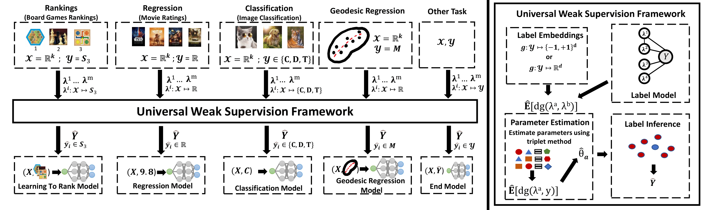
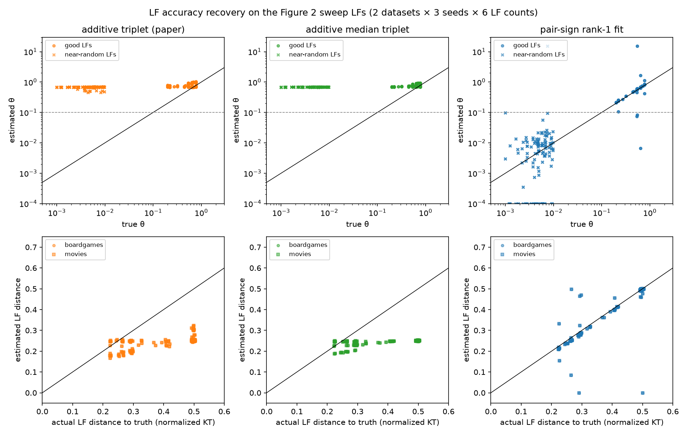

# Universalizing Weak Supervision

[](https://github.com/SprocketLab/universalizing-weak-supervision/actions/workflows/ci.yml)
[](https://universalizing-weak-supervision.readthedocs.io)
[](LICENSE)
[](https://arxiv.org/abs/2112.03865)



Weak supervision trains models from noisy, cheap label sources (heuristics, other models, crowd workers)
instead of hand labels. Most tools only handle classification. **`uws` handles any label type**: rankings,
real numbers, points in a graph or any other finite metric space, and points on a manifold.

It is the library for the ICLR 2022 paper
[Universalizing Weak Supervision](https://arxiv.org/abs/2112.03865)
(Changho Shin, Winfred Li, Harit Vishwakarma, Nicholas Roberts, Frederic Sala).

## The idea in one paragraph

Each label source, or *labeling function* (LF), is modeled as a noisy copy of the true label: the further an
output is from the truth, the less likely it is, and each LF has its own accuracy parameter θ. These θ can be
estimated **without any labels**, just from how often the LFs agree with each other. The label model then
combines the LF outputs with an accuracy-weighted average that makes sense for the label type (for rankings,
a weighted Kemeny ranking; for real values, a posterior mean).

| Label type | Label model | How LFs are combined |
|---|---|---|
| Full or partial rankings | `uws.ranking.RankingLabelModel` | weighted Kemeny (also pairwise majority, position estimation) |
| Real values | `uws.regression.ContinuousLabelModel` | Gaussian posterior mean |
| Any finite metric space | `uws.metric.MetricLabelModel` | weighted Fréchet mean |
| Manifolds (e.g. hyperbolic space) | `uws.geodesic.GeodesicLabelModel` | Riemannian Fréchet mean |
| Binary | `uws.binary.BinaryLabelModel` | FlyingSquid |

## Installation

```bash
pip install uws                  # rankings, regression, metric spaces
pip install "uws[geodesic]"      # adds manifold-valued labels (torch, geoopt)
pip install "uws[l2r]"           # adds learning-to-rank end models (torch)
pip install "uws[all]"           # everything, including the Snorkel baseline
```

To work on the code: `git clone` this repository and run `pip install -e ".[dev,all]"`. Python 3.9 or newer.

## Quickstart: rankings

Six LFs rank the same 5 items. Three of them are essentially random; the label model has to figure that out
on its own.

```python
import numpy as np
from uws.ranking import RankingLabelModel, RankingUtils, generate_true_rankings, sample_mallows_LFs

rng = np.random.default_rng(0)
r_utils = RankingUtils(d=5)                         # rankings of 5 items
Y = generate_true_rankings(5, 1000, rng, r_utils)   # true rankings (only used for evaluation here)
L = sample_mallows_LFs(Y, 6, [0.01, 0.01, 0.01, 0.5, 1.0, 2.0], rng=rng)   # 6 LFs, 3 near-random

lm = RankingLabelModel(r_utils, train_method="sign_triplet_opt")   # see "Choosing an estimator" below
lm.fit(L)                                   # no labels needed
Y_hat = lm.predict(L)                       # weighted Kemeny aggregation

print(lm.thetas)                            # [0.1  0.1  0.1  0.55 1.08 1.88]: the random LFs are found
print(r_utils.mean_kt_distance(Y_hat, Y))   # 0.061 (normalized Kendall tau distance, lower is better)
print(r_utils.mean_kt_distance(lm.predict(L, inference_rule="kemeny"), Y))   # 0.186 without weights
```

Every label model follows the same pattern: `fit(L)`, `predict(L)`, `get_weights()`, `save()` / `load()`.

### Choosing an estimator for rankings

There are two ways to estimate the LF accuracies, and both are supported:

| `train_method` | What it does | Use it when |
|---|---|---|
| `median_triplet_opt` (default), `triplet_opt` | The paper's method: assumes LF-to-LF distances add up, `E d(a, b) ≈ E d(a, y) + E d(b, y)`, and solves for each LF from triplets. | You have few LFs (3 to 5), or you want the paper's behavior. |
| `sign_triplet_opt` | Looks at every pair of items separately. Two independent LFs agree on a pair at a rate that factors as `s_a · s_b`, which is exact for Kendall distance. Fits the `s` by least squares over all LF pairs. | You have 6 or more LFs and some of them may be close to random. |

Why the difference matters: two random rankings disagree on half of all pairs, not on "half plus half". The
additive rule therefore thinks random LFs are much better than they are and gives them almost as much weight
as good ones. On the LFs from the paper's Figure 2 experiment:



The pair-sign fit needs at least three informative LFs. With only one or two good LFs (3 and 6 LFs in the
paper's setup, the outliers above) it cannot tell their accuracies apart: at 6 LFs the end model still comes
out ahead, at 3 LFs it is worse than the paper's estimator.

## Other label types

Real values, with the posterior variance for each prediction:

```python
from uws.regression import ContinuousLabelModel

lm = ContinuousLabelModel().fit(L_train, var_Y)     # L_train: (n, m) array; var_Y: variance of the label
y_hat, var = lm.predict(L_test, return_var=True)
```

Any finite metric space, here the nodes of a graph with shortest-path distances `D`:

```python
from uws.metric import MetricLabelModel

lm = MetricLabelModel(D).fit(L)    # L: (n, m) node indices, -1 where an LF abstains
y_hat = lm.predict(L)
proba = lm.predict_proba(L)        # distribution over the nodes for each example
```

## Reproducing the paper

The notebooks in [`tutorials/`](tutorials) walk through the experiments:

* **Rankings on real data:** `tutorials/{boardgames,movies}/RankingExperiments.ipynb`. Settings live in
  `configs/{boardgames,movies}_ranking_experiment.yaml`; the main ones are the number of LFs (`num_LFs`), the
  aggregation rule (`inference_rule`) and, for partial rankings, the fraction of observed items (`p`).
* **Synthetic rankings:** `tutorials/synthetic/`; `Ranking-Example.ipynb` is the shortest introduction.
* **Regression:** `tutorials/{boardgames,movies}/RegressionExperiments.ipynb`,
  `tutorials/synthetic/Regression-Experiments.ipynb`.
* **Hyperbolic (geodesic) regression:** `tutorials/geodesic-regression/geodesic_regression.ipynb`.
* **Generic metric spaces:** `tutorials/metric-spaces/generic_metric_spaces.ipynb`.

The real-data ranking pipeline also runs from the command line:

```bash
uws-experiment configs/boardgames_ranking_experiment.yaml --project-root . \
    --set weak_sup_conf.num_LFs=6 --train
```

[`benchmarks/paper_ranking/`](benchmarks/paper_ranking) re-runs Figure 2 of the paper (end-model quality as
the number of LFs grows). The method ranking from the paper reproduces (ours beats majority vote, which beats
Snorkel), and the numbers are close. The fully supervised baselines come out stronger than in the paper,
so the claim that weak supervision beats training on 20% of the labels holds only for the newer
`sign_triplet_opt` estimator with 15 or more LFs. The full tables are in
[`benchmarks/paper_ranking/summary_tables.md`](benchmarks/paper_ranking/summary_tables.md).

### What changed since the paper's code

Version 1.0 fixes bugs in the original research code and replaces a few approximations
([CHANGELOG.md](CHANGELOG.md) has the full list). The ones that change numbers:

* `kemeny` now finds the true Kemeny ranking. The paper picked the best of the LFs' own rankings; that rule
  is still available as `kemeny_medoid`.
* Kendall distance for partial rankings follows Fagin et al. (2006).
* Mallows sampling is exact.
* The Gaussian label model no longer inverts ill-conditioned matrices, so it does not blow up with
  correlated or many LFs.

To get the paper's behavior back, pass `legacy=True` to `RankingUtils`, `ContinuousLabelModel` or
`GeodesicLabelModel`, and `sampler="legacy"` to `Mallows`. In experiment configs, set
`weak_sup_conf.legacy: true` and `data_conf.legacy_sampling: true`.

## Development

```bash
pip install -e ".[dev,all]"
pre-commit install
pytest
ruff check uws tests
```

Build the documentation with `pip install -e ".[docs]" && sphinx-build docs docs/_build`.
See [CONTRIBUTING.md](CONTRIBUTING.md) for the rules on changes that affect numerical results.

## Citation

```bibtex
@inproceedings{shin2022universalizing,
  title={Universalizing Weak Supervision},
  author={Shin, Changho and Li, Winfred and Vishwakarma, Harit and Roberts, Nicholas Carl and Sala, Frederic},
  booktitle={The Tenth International Conference on Learning Representations},
  year={2022}
}
```

## License

Apache-2.0. `uws/_vendor/ptranking` is a modified copy of [PT-Ranking](https://github.com/wildltr/ptranking)
(MIT License).
